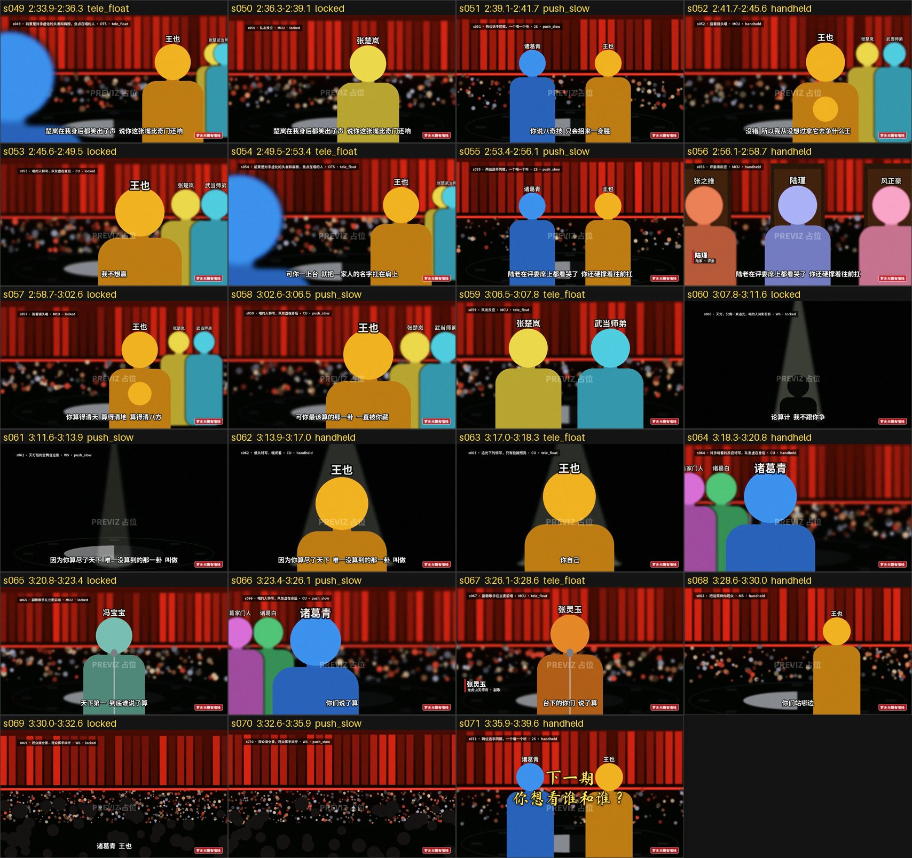

# 罗天大醮有嘻哈 第一期：诸葛青 VS 王也 · 动态分镜 demo

这是一版动态分镜（animatic），只用来检查结构、节奏和包装：

- 画面是带标注的占位卡片，没有真实生成的画面，也还没有定妆图。
- 音频是合成的 92 BPM 节拍音轨，每个唱到的字对应一声提示音。

《一人之下》同人二创（腾讯动漫，作者米二），AI生成 仅供娱乐。

## 视频

[animatic_480p.mp4](wangye_vs_zhugeqing/animatic_480p.mp4)（3:39.6，854x480，H.264 + AAC）

## 分镜总览

### 第 1 张：s001-s024（0:00.0–1:12.7）

### 第 2 张：s025-s048（1:12.7–2:33.9）

### 第 3 张：s049-s071（2:33.9–3:39.6）

## 来源

由分支 `feat/cinematic-battle-pipeline`（PR #1）生成。
