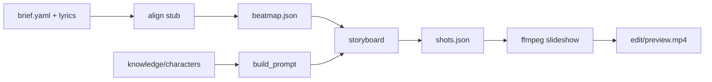

# aigc-mv-pipeline

**CN**｜受 [claudia.gallery](https://claudia.gallery/) 启发的 **AI 音乐视频流水线脚手架**：知识层（角色 canon + `build_prompt`）+ 代码流水线（对齐 → 分镜 → ffmpeg 预览）。演示角色为原创「酒楼诗人」，**不复制 Claudia IP**。

**EN**｜Scaffold for an AI music-video pipeline inspired by Claudia’s canon-MCP + workflow idea: knowledge layer + local align/storyboard/preview. Demo cast is an original poet character—not Claudia.

## Architecture

```
┌──────────────────────────────────────────┐
│  Knowledge layer (YAML / optional MCP)   │
│  get_canon · build_prompt · list_chars   │
└─────────────────┬────────────────────────┘
                  │
┌─────────────────▼────────────────────────┐
│  Pipeline                                │
│  align → storyboard → preview (ffmpeg)   │
│  (later: plates / I2V / lip-sync / QC)   │
└──────────────────────────────────────────┘
```



## Quick start

```bash
cd /workspace/aigc-mv-pipeline
python3 -m venv .venv
source .venv/bin/activate
pip install -e ".[dev]"

# Canon
aigc-mv list-characters
aigc-mv get-canon example_poet
aigc-mv build-prompt example_poet --scene "tavern stage, vintage mic" --framing MCU

# Demo pipeline
aigc-mv align projects/demo_og
aigc-mv storyboard projects/demo_og
aigc-mv preview projects/demo_og
# → projects/demo_og/edit/preview.mp4

pytest
```

New project from demo template:

```bash
aigc-mv init-project my_mv
```

## CLI

| Command | Purpose |
|---------|---------|
| `aigc-mv init-project NAME` | Copy demo structure |
| `aigc-mv get-canon CHAR_ID` | Print canon JSON |
| `aigc-mv build-prompt CHAR_ID --scene "..."` | Midjourney-style prompt |
| `aigc-mv align PROJECT` | Write `beatmap.json` (equal-split stub) |
| `aigc-mv storyboard PROJECT` | Write `shots.json` |
| `aigc-mv preview PROJECT` | ffmpeg plate slideshow MP4 |

## `build_prompt` order

1. framing  
2. **identity text (verbatim from YAML)**  
3. wardrobe  
4. scene  
5. style family  
6. `no text, no letters, no logos`

## MCP (optional)

See [`mcp_server/README.md`](mcp_server/README.md). Tool signatures match Claudia-style: `list_characters`, `get_canon`, `build_prompt`.

```bash
pip install -e ".[mcp]"
python mcp_server/server.py   # stdio FastMCP when `mcp` is installed
```

## Next steps

1. Replace align stub with **WhisperX** forced alignment (`pip install whisperx` + real `audio/*.wav`).  
2. Wire plate generation to Flux / Midjourney using `shots[].plate_prompt`.  
3. Add I2V worker (Seedance / Kling / …) + optional lip-sync.  
4. Serve canon over **Streamable HTTP MCP** for Claude Code / Cursor:  
   `claude mcp add --transport http aigc-mv https://your.host/mcp`  
5. Human gates before any paid API spend.

## License

MIT — demo character and lyrics are original stubs for local testing.
