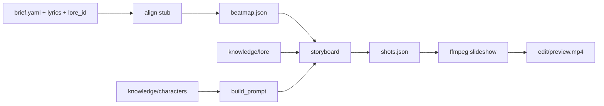

# aigc-mv-pipeline

**CN**｜受 [claudia.gallery](https://claudia.gallery/) 启发的 **AI 音乐视频流水线脚手架**：知识层（角色 canon + **典故 lore** + `build_prompt`）+ 代码流水线（对齐 → 分镜 → ffmpeg 预览）。演示角色为原创「酒楼诗人」，**不复制 Claudia IP**。典故层用《史记》《左传》故事做**借古讽今**剧情/歌词底本——**不讽刺政治**。

**EN**｜Scaffold for an AI music-video pipeline inspired by Claudia’s canon-MCP + workflow idea: knowledge layer (canon + classical lore allegory) + local align/storyboard/preview. Demo cast is an original poet character—not Claudia. Lore cards allegorize workplace/friendship/craft themes; no political satire.

## Architecture

```
┌──────────────────────────────────────────┐
│  Knowledge layer (YAML / optional MCP)   │
│  characters · lore · build_prompt        │
└─────────────────┬────────────────────────┘
                  │
┌─────────────────▼────────────────────────┐
│  Pipeline                                │
│  align → storyboard → preview (ffmpeg)   │
│  (later: plates / I2V / lip-sync / QC)   │
└──────────────────────────────────────────┘
```



## Quick start

```bash
cd /workspace/aigc-mv-pipeline
python3 -m venv .venv
source .venv/bin/activate
pip install -e ".[dev]"

# Canon + lore
aigc-mv list-characters
aigc-mv get-canon example_poet
aigc-mv list-lore
aigc-mv lyric-brief guan_bao_zhi_jiao
aigc-mv build-prompt example_poet --scene "tavern stage, vintage mic" --framing MCU

# Demo pipeline (original OG demo)
aigc-mv align projects/demo_og
aigc-mv storyboard projects/demo_og
aigc-mv preview projects/demo_og

# Lore-linked demo（管鲍之交）
aigc-mv align projects/demo_guanbao
aigc-mv storyboard projects/demo_guanbao

pytest
```

New project from demo template:

```bash
aigc-mv init-project my_mv
# then set lore_id in projects/my_mv/brief.yaml and rewrite lyrics.txt
```

## Lore · 典故层

- Cards live in [`knowledge/lore/`](knowledge/lore/) — see [README](knowledge/lore/README.md).
- Creative rule: **借古讽今，但不讽刺政治**（职场信用、友情、长期主义、手艺等 OK）。
- `brief.yaml` may set `lore_id`; `storyboard` lightly injects allegory/themes into shot action & plate context.
- `aigc-mv lyric-brief LORE_ID` prints a Chinese songwriting brief.

Bundled cards: `guan_bao_zhi_jiao`（管鲍之交）, `wan_bi_gui_zhao`（完璧归赵）, `wo_xin_chang_dan`（卧薪尝胆 / craft persistence）.

## CLI

| Command | Purpose |
|---------|---------|
| `aigc-mv init-project NAME` | Copy demo structure |
| `aigc-mv get-canon CHAR_ID` | Print canon JSON |
| `aigc-mv build-prompt CHAR_ID --scene "..."` | Midjourney-style prompt |
| `aigc-mv list-lore` | List lore card IDs |
| `aigc-mv get-lore LORE_ID` | Print lore JSON |
| `aigc-mv lyric-brief LORE_ID` | Chinese lyric writing brief |
| `aigc-mv align PROJECT` | Write `beatmap.json` (equal-split stub) |
| `aigc-mv storyboard PROJECT` | Write `shots.json` |
| `aigc-mv preview PROJECT` | ffmpeg plate slideshow MP4 |

## `build_prompt` order

1. framing  
2. **identity text (verbatim from YAML)**  
3. wardrobe  
4. scene  
5. style family  
6. `no text, no letters, no logos`

## MCP (optional)

See [`mcp_server/README.md`](mcp_server/README.md). Tool signatures match Claudia-style: `list_characters`, `get_canon`, `build_prompt`.

```bash
pip install -e ".[mcp]"
python mcp_server/server.py   # stdio FastMCP when `mcp` is installed
```

## Next steps

1. Pick a lore card → `lyric-brief` → write/Suno lyrics → drop `audio/*.wav`.  
2. Replace align stub with **WhisperX** forced alignment.  
3. Wire plate generation to Flux / Midjourney using `shots[].plate_prompt`.  
4. Add I2V worker (Seedance / Kling / …) + optional lip-sync.  
5. Serve canon/lore over **Streamable HTTP MCP**.  
6. Human gates before any paid API spend.

## License

MIT — demo character, lore allegories, and lyrics are original stubs for local testing.
