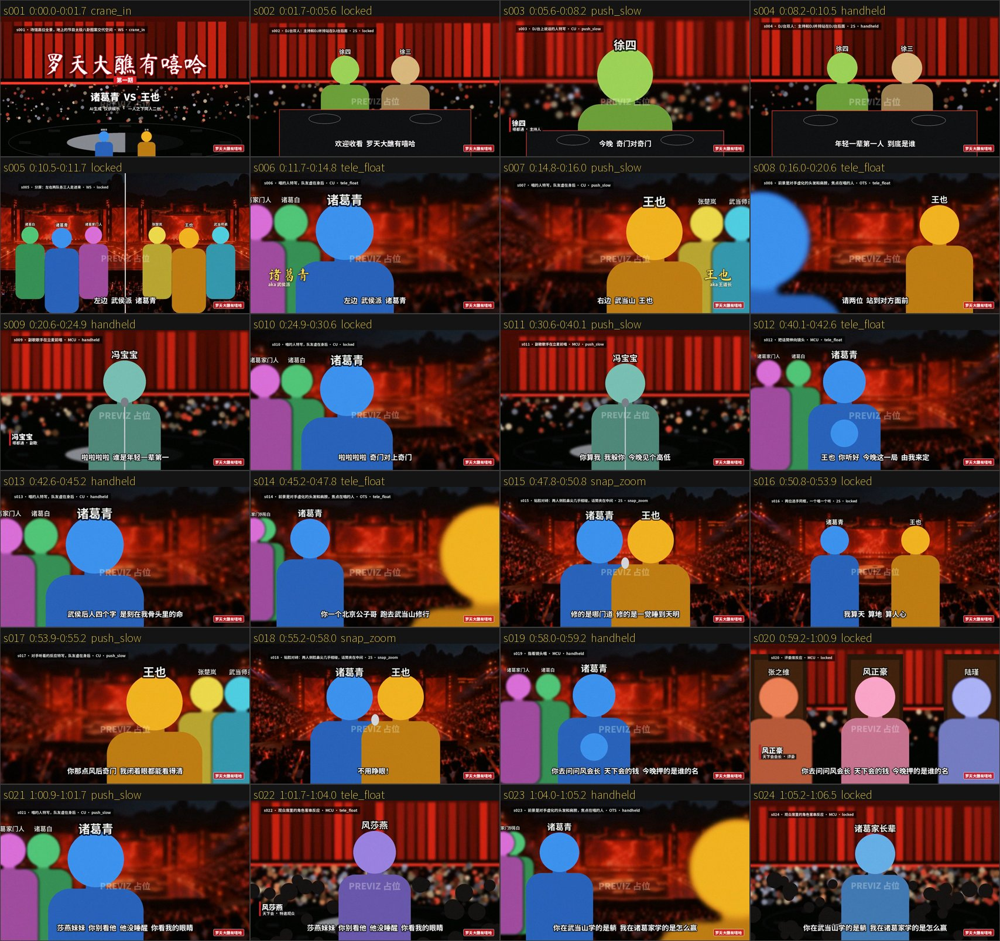
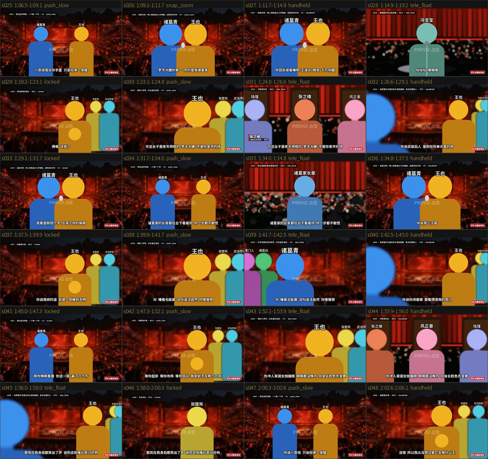
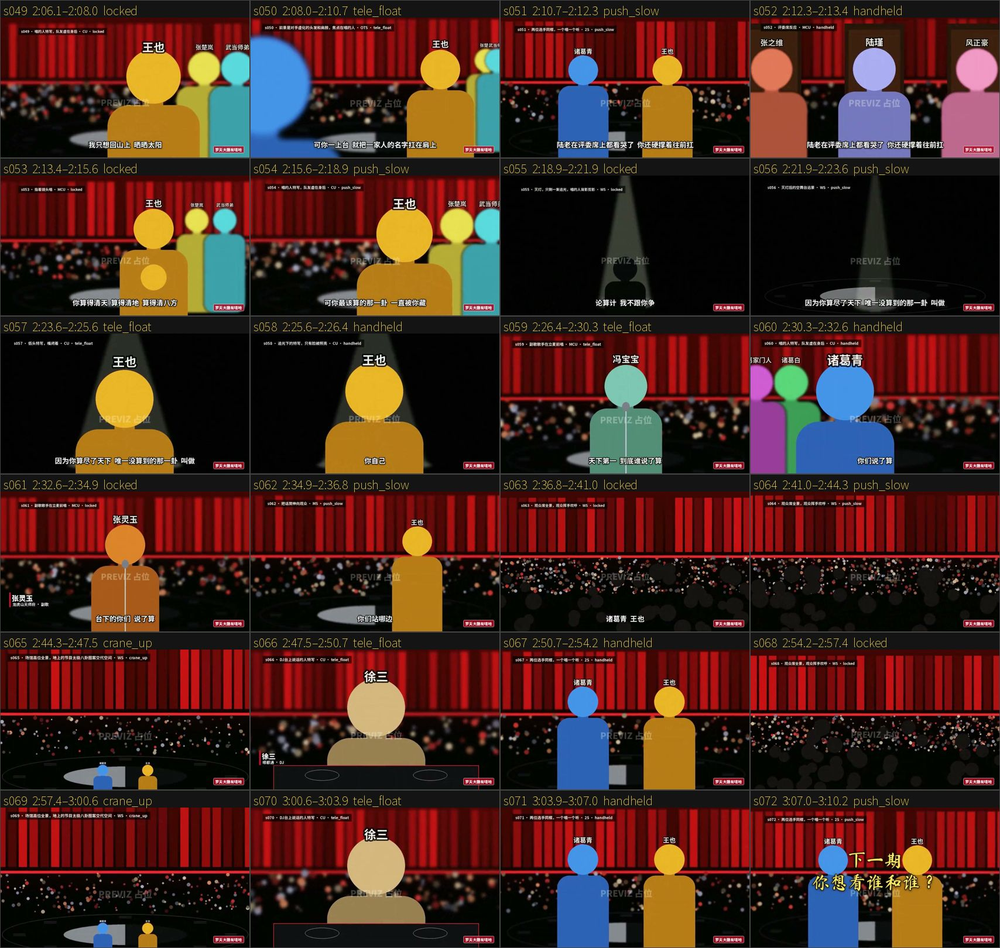
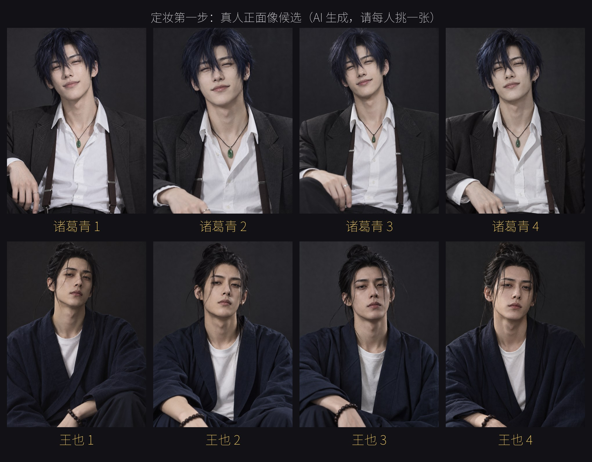
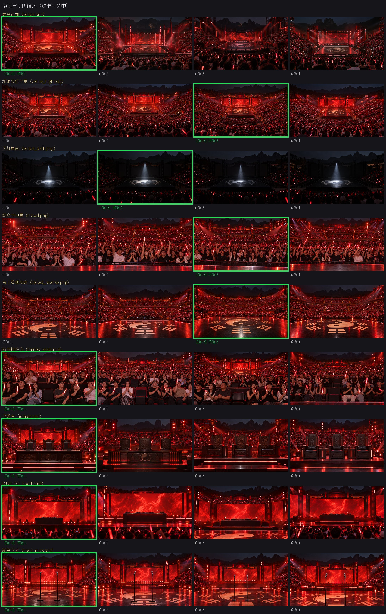
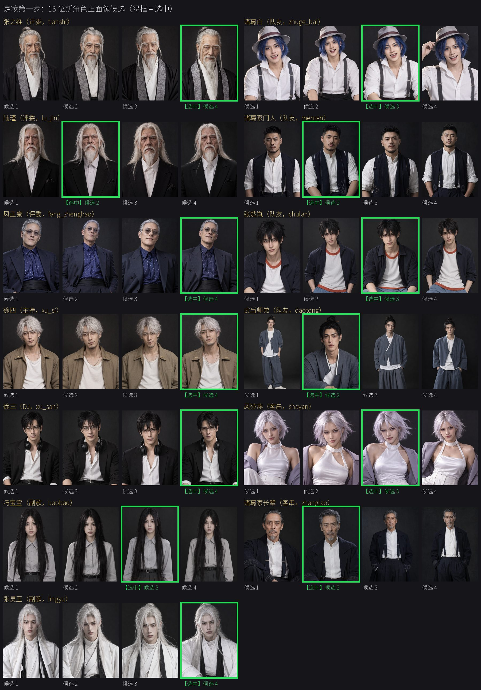
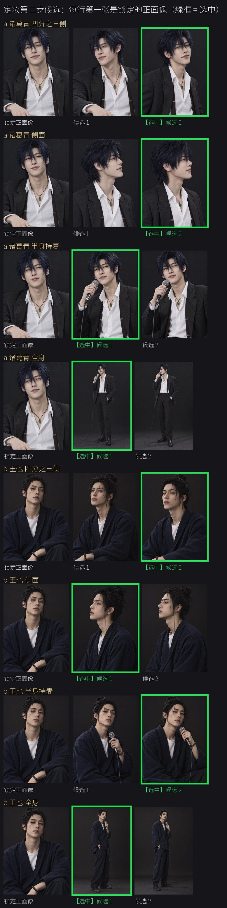

# 罗天大醮有嘻哈 第一期：诸葛青 VS 王也 · 动态分镜 demo

这是一版动态分镜（animatic），只用来检查结构、节奏和包装：

- 音频是真实的 Suno 歌曲（190.2 秒，93.5 BPM），分镜已按这首歌对时。
- 人物仍是带标注的占位剪影；但 72 个镜头的背景已经全部换成锁定的真实场景图（9 张：舞台正面 44 镜、DJ 台 5、副歌立麦 5、评委席 4、灭灯舞台 4、高位全景 3、前两排座位 3、观众席 3、台上看观众席 1）。

《一人之下》同人二创（腾讯动漫，作者米二），AI生成 仅供娱乐。

## 视频

[animatic_480p.mp4](wangye_vs_zhugeqing/animatic_480p.mp4)（3:10.2，854x480，H.264 + AAC）

## 分镜总览

每格标注：镜头编号、起止时间、运镜方式。共 72 个镜头。

### 第 1 张：s001-s024（0:00.0–1:06.5）

### 第 2 张：s025-s048（1:06.5–2:06.1）

### 第 3 张：s049-s072（2:06.1–3:10.2）

## 定妆第一步：真人正面像候选（请挑选）

- 这些都是 AI 生成的偶像感真人正面像（GPT Image 2.5，第一轮经 OpenRouter、第二轮经 APIMart 调用），依据官方角色设定的发色、发型、眼睛、招牌物件和服装配色。
- 脸是原创的，不能像任何真人演员或明星。
- 这只是定妆第一步（正面像）。侧面、全身、服装细节放到后面几步做。
- 已锁定：诸葛青 = 候选 2，王也 = 候选 1（你让我们代选，理由见下方“本轮代选结果”）。

单张大图（768x1024）：

| 编号 | 诸葛青 | 王也 |
|---|---|---|
| 1 | [a_zhugeqing_1.jpg](wangye_vs_zhugeqing/faces/a_zhugeqing_1.jpg) | [b_wangye_1.jpg](wangye_vs_zhugeqing/faces/b_wangye_1.jpg) |
| 2 | [a_zhugeqing_2.jpg](wangye_vs_zhugeqing/faces/a_zhugeqing_2.jpg) | [b_wangye_2.jpg](wangye_vs_zhugeqing/faces/b_wangye_2.jpg) |
| 3 | [a_zhugeqing_3.jpg](wangye_vs_zhugeqing/faces/a_zhugeqing_3.jpg) | [b_wangye_3.jpg](wangye_vs_zhugeqing/faces/b_wangye_3.jpg) |
| 4 | [a_zhugeqing_4.jpg](wangye_vs_zhugeqing/faces/a_zhugeqing_4.jpg) | [b_wangye_4.jpg](wangye_vs_zhugeqing/faces/b_wangye_4.jpg) |

## 第二轮代选结果（2026-11-03，改用 APIMart）

图像接口已从 OpenRouter 换成 **APIMart**（同一个模型 GPT-Image-2.5，`gpt-image-2.5-sunburst`，1k、high 画质）。OpenRouter 那把 key 的额度用完了，所以上一轮没做完的部分这一轮补上了。

和上一轮一样，下面每一项都是我们看图后代选的，所有候选都保留着。**想换哪张，直接回复“名字 + 候选号”**，例如“风莎燕 1”“crowd 2”“诸葛白 4”。

### 场景背景图：9 张全部锁定

- 高位全景 venue_high = 候选 3：四张里机位最高，一圈看台全坐满，太极八卦台和红色 LED 墙居中，龙虎山剪影在后，和 venue 是同一个场馆。[大图](wangye_vs_zhugeqing/plates/venue_high.jpg)
- 灭灯舞台 venue_dark = 候选 2：只剩一束白色顶光落在太极台正中，台面最大最居中；看台全黑，只有剪影和零星红色荧光棒。[大图](wangye_vs_zhugeqing/plates/venue_dark.jpg)
- 观众席 crowd = 候选 3：从前排到顶层全坐满，前排是各不相同的普通成年人脸，衣服基本是素色，没有可读的文字。[大图](wangye_vs_zhugeqing/plates/crowd.jpg)
- 台上看观众席 crowd_reverse = 候选 3：前景是太极八卦台面，三层看台全满，龙虎山剪影在后，最能交代“从台上看观众”。[大图](wangye_vs_zhugeqing/plates/crowd_reverse.jpg)
- 前两排座位 cameo_seats = 候选 1：第一排正中空一个座（留给诸葛家长辈），第二排中间偏左空一个座（留给风莎燕），其余座位全满。[大图](wangye_vs_zhugeqing/plates/cameo_seats.jpg)
- 评委席 judges = 候选 1：三把雕花红木评委椅，桌面正面浮雕龙纹和太极，身后是 LED 墙和坐满的看台，和场馆最一致。[大图](wangye_vs_zhugeqing/plates/judges.jpg)
- DJ 台 dj_booth = 候选 1：DJ 台居中，LED 墙满屏，上方看台和前景观众都坐满，道观门楼在后。[大图](wangye_vs_zhugeqing/plates/dj_booth.jpg)
- 副歌立麦 hook_mics = 候选 1：两支立麦并排立在太极台中心，两侧看台坐满，构图对称，适合副歌合唱镜头。[大图](wangye_vs_zhugeqing/plates/hook_mics.jpg)

所有场景图都没有文字、字母或标志。

### 定妆第一步：13 位新角色全部有图了

新做的 5 位（每人 4 张候选）：

- 张楚岚 = 候选 3：歪嘴坏笑最有张楚岚的贱萌，黑色碎发、深色夹克配红领口白 T，二十出头。
- 风莎燕 = 候选 3：挑衅的自信笑，上挑的浅紫色眼睛，银紫短发，白色挂脖上衣加淡紫外套，成年。**四张都修得偏光滑，请你亲自看一下。**
- 诸葛家门人 = 候选 2：唯一一张标准正面头肩像。方脸浓眉，眼睛小而沉稳，短须，下巴有卡片要求的小疤，白立领衬衫配藏青背带长马甲，二十八岁左右。
- 武当师弟 = 候选 2：唯一一张标准正面头肩像（其余三张是全身），长脸浓眉，眼神认真，木簪道髻，灰蓝交领短褂带白边，二十岁上下。
- 诸葛家长辈 = 候选 2：标准正面头肩像，六十出头的老相（皱纹、老年斑），灰白山羊胡，银灰背头，抿着嘴显得倨傲。

重选的 2 位（各补了 3 张，在 4 张里重新挑）：

- 张灵玉：原来是候选 1，**改为候选 4**。四张里最成熟，皮肤质感最真实，神情冷静克制，白发半扎、白色交领道袍黑衣缘都对，明确是成年人（二十四岁左右）。
- 诸葛白：原来是候选 1（看着偏小），**改为候选 3**。下颌线更硬朗，明确是成年人（二十岁左右），蓝色齐下巴短发、浅灰礼帽酒红帽带、背带白衬衫和灿烂的笑都在。

另外 8 位（张之维、陆瑾、风正豪、徐四、徐三、冯宝宝，以及诸葛青、王也）的选择不变。

**建议你亲自看一下**：风莎燕（偏精修）、张楚岚（四张都偏偶像脸）、张灵玉和诸葛白（这次是重选）、诸葛家长辈（要确认不像任何真人演员）。

### 本轮花费（APIMart 任务结果里返回的 `cost`，是真实扣费）

- 本轮：58 张图，$1.8516（上限 $4.00）。其中场景图 32 张 $0.9972，正面像 26 张 $0.8544。没有失败或被拒的请求。
- 每张约 $0.031（16:9 场景图）到 $0.037（带参考图的 3:4 正面像）。
- 累计（本地账本，OpenRouter + APIMart）：112 张图，$4.7777。

## 第一轮代选结果（2026-11-03）

你说“第一点你来定”，所以下面每一项都是我们看图后代选的。所有候选都保留着，想换哪张，直接回复“名字 + 候选号”，例如“王也 3”“venue 2”“冯宝宝 1”。

### 定妆第一步：诸葛青、王也锁定

- 诸葛青 = 候选 2：深藏青长侧刘海、眯眼笑、绿玉坠、背带和炭灰西装保留得最完整。
- 王也 = 候选 1：神态最懒散放松，最像王也。

### 场景背景图（当时 9 张里只做成 1 张）

- 舞台正面 venue = 候选 1：舞台最大最居中，太极八卦地面最清楚，红色 LED 墙满屏，两侧和前景看台坐满，背后是龙虎山剪影，画面里没有文字。大图：[venue.jpg](wangye_vs_zhugeqing/plates/venue.jpg)
- 另外 8 张当时**没有生成**（OpenRouter key 额度用完），第二轮已经补齐，见上方。

### 定妆第二步：诸葛青、王也（每个角度 2 张候选）

脸、发型、服装和正面像一致，成年比例，全身图手脚完整。

| 角度 | 诸葛青 | 王也 |
|---|---|---|
| 四分之三侧 | 候选 2：角度最标准，刘海、眯眼笑、玉坠、背带都在 | 候选 2：半睁的懒眼最像王也，角度标准 |
| 侧面 | 候选 2：更标准的正侧面 | 候选 1：轮廓干净，丸子头和散落发丝清楚 |
| 半身持麦 | 候选 1：眯眼笑最像正面像，左眼下的痣还在 | 候选 2：肩膀更松、更懒，持麦的手和木珠手串完整 |
| 全身 | 候选 1：头到鞋完整，西装敞开、背带和皮靴都在 | 候选 1：站姿最松垮，一手插兜，宽裤和帆布高帮鞋完整 |

组图：[a_sheet.jpg（诸葛青）](wangye_vs_zhugeqing/sheets/a_sheet.jpg) · [b_sheet.jpg（王也）](wangye_vs_zhugeqing/sheets/b_sheet.jpg)。可选的表情格没有做。

### 定妆第一步：其余 13 位（当时 8 位有图，5 位没出图）

- 张之维 = 候选 4：明显九十岁上下，深皱纹、老年斑、白长须、脑后小髻，眼神带笑。
- 陆瑾 = 候选 2：眉头锁得最紧，白长发中分过肩，白须，八十多岁的老相。
- 风正豪 = 候选 4：只有这张是接近透明的细圆框眼镜（其余三张偏墨镜），灰白背头，五十岁左右。
- 徐四 = 候选 4：嘴角歪笑最痞，银白乱发、小山羊胡、卡其夹克。
- 徐三 = 候选 4：神情最沉稳，细长方框眼镜，挂着耳机。
- 冯宝宝 = 候选 3：面无表情、眼神直，长直黑发；四张里最像成年女性。
- 张灵玉 = 候选 1（只生成出 1 张）：白长发半扎、神情冷静、白色交领道袍。第二轮已改为候选 4。
- 诸葛白 = 候选 1（只生成出 1 张）：蓝色齐下巴短发、礼帽、背带白衬衫，是成年人但看着偏小。第二轮已改为候选 3。
- 诸葛家门人、张楚岚、武当师弟、风莎燕、诸葛家长辈：当时额度用尽，没有生成，第二轮已补齐。

## 第一轮花费（OpenRouter 返回的 usage.cost）

- 本轮：46 张图，$2.4669（场景图 4 张 $0.1355，第二步 16 张 $0.8935，第一步 26 张 $1.4379）。另外 26 次请求被 OpenRouter 以 HTTP 403 “Key limit exceeded” 拒绝，不出图也不扣费。
- 累计（本地账本）：54 张图，$2.926。
- OpenRouter 那边显示这把 key 已经用了约 $5.09–5.42，超出了它自带的 $5.00 总额度（不会重置）。这比本地账本多出约 $2.2–2.5，可能是这把 key 在别处也用过。之后已改用 APIMart 继续生成。

## 来源

由分支 `feat/cinematic-battle-pipeline`（PR #1）生成。

场景背景图和真实歌曲对时报告见分支 `feat/cinematic-battle-pipeline` 上的 `docs/examples/王也vs诸葛青_场景背景图.md` 和 `docs/examples/王也vs诸葛青_真实歌曲对时报告.md`。
