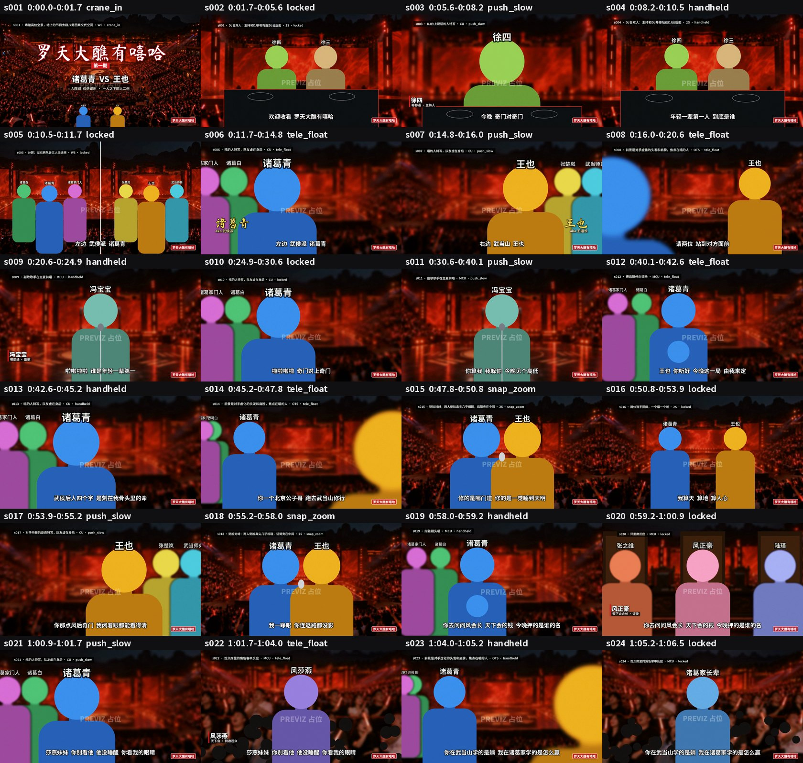
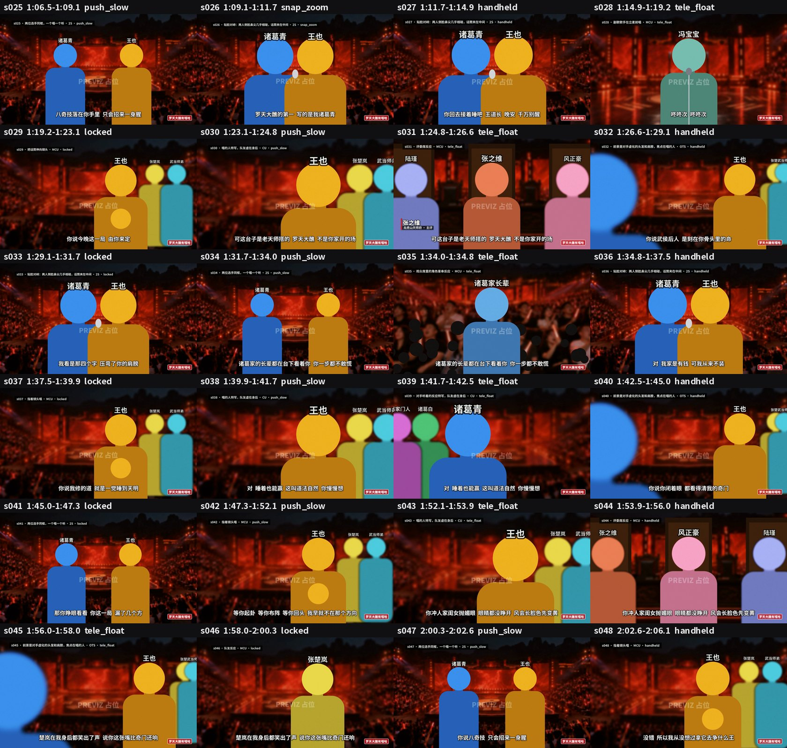
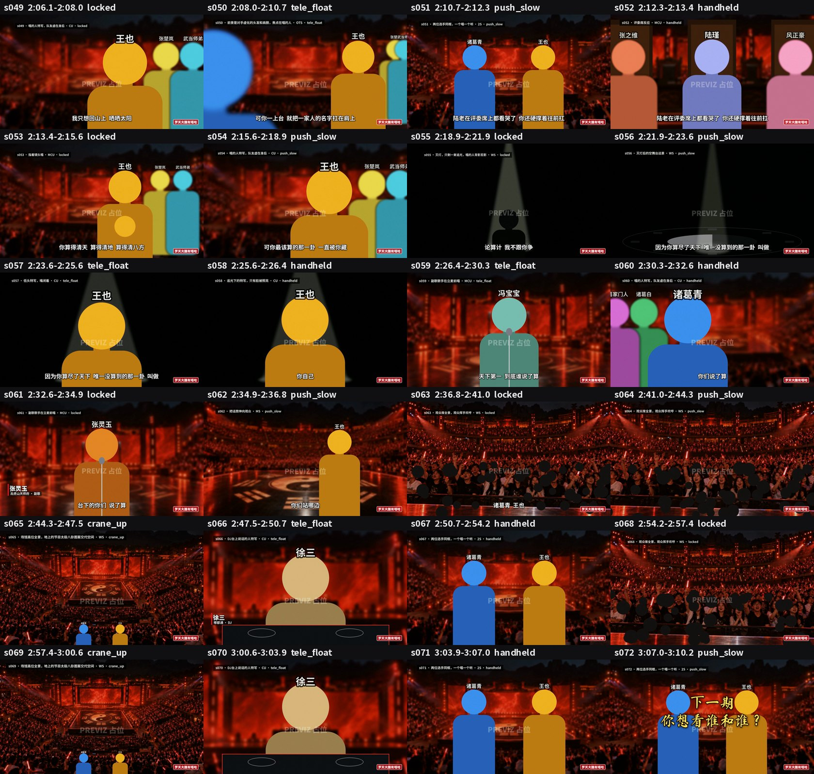
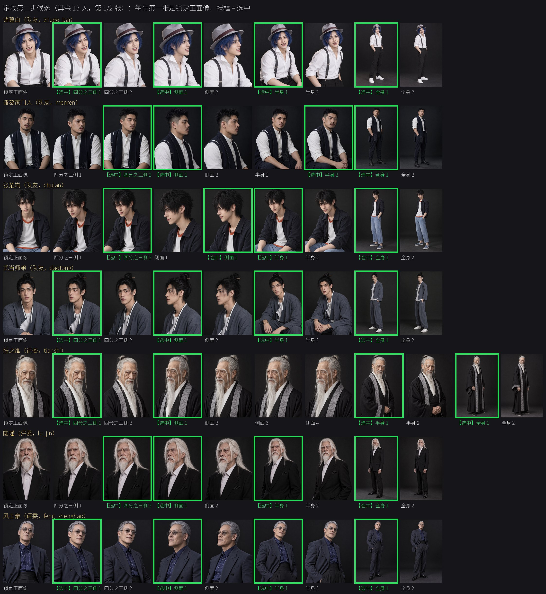
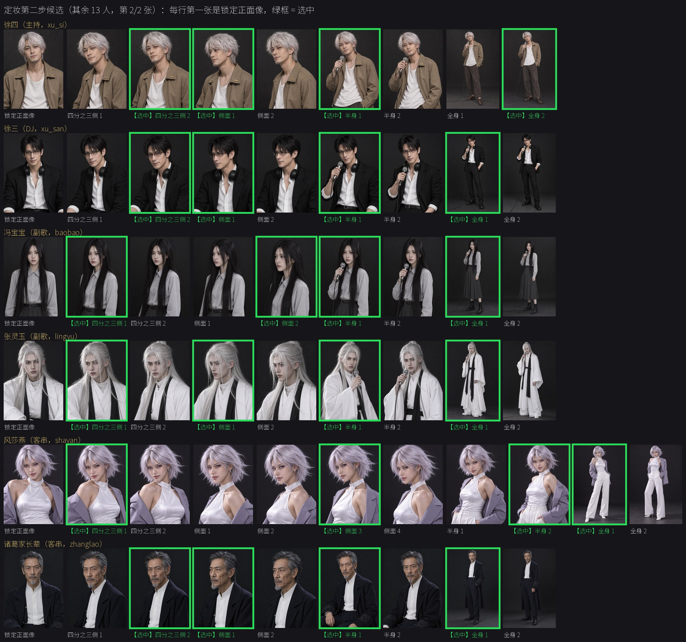

# 罗天大醮有嘻哈 第一期：诸葛青 VS 王也 · 动态分镜 demo

这是一版动态分镜（animatic），只用来检查结构、节奏和包装：

- 音频是真实的 Suno 歌曲（190.2 秒，93.5 BPM），分镜已按这首歌对时。
- 人物仍是带标注的占位剪影；但 72 个镜头的背景已经全部换成锁定的真实场景图（9 张：舞台正面 44 镜、DJ 台 5、副歌立麦 5、评委席 4、灭灯舞台 4、高位全景 3、前两排座位 3、观众席 3、台上看观众席 1）。

《一人之下》同人二创（腾讯动漫，作者米二），AI生成 仅供娱乐。

## 最终预览剪辑（预览 / animatic 版本，不是最终 AI 视频）

这是本期能交付的最好版本：一版 1080p 的预览剪辑（预览 / animatic），用真实 Suno 歌曲、调色、白色广播字幕、节目台标、人名条、片头片尾卡，把整期节目完整走了一遍。

**它为什么不是最终 AI 视频？** 因为 Dreamina 的视频生成被账号层面的风控拦截了：每一次视频生成请求都被服务端风控直接拒绝，需要账号持有人本人去做人工核验 / 申诉之后才能解除，这个动作在我们这边无法完成，也不允许绕过。所以目前没有任何一条 AI 视频镜头被生成出来（0 条），画面里的人物仍然是带标注的占位剪影（PREVIZ 占位），背景用的是已锁定的真实场景图。等账号的视频权限被持有人解除后，才能把这版预览替换成真正的 AI 视频。

### 怎么看

完整 720p 预览（19.3 MB，1280x720，H.264 CRF 23 + AAC 192k，已 faststart）：

[preview_720p.mp4](wangye_vs_zhugeqing/preview_720p.mp4)（3:10.2）

因为推送有单文件体积限制，同一支片子也切成了 3 段（每段 < 8 MB，直接流拷贝、无重新编码）：

- [preview_720p_part00.mp4](wangye_vs_zhugeqing/preview_720p_part00.mp4)（约 0:00–1:11）
- [preview_720p_part01.mp4](wangye_vs_zhugeqing/preview_720p_part01.mp4)（约 1:11–2:21）
- [preview_720p_part02.mp4](wangye_vs_zhugeqing/preview_720p_part02.mp4)（约 2:21–3:10.2）

三段可以按顺序单独播放；也可以用 ffmpeg 的 concat 分离器把它们无损拼回一整支（新建一个文本文件，每行写 `file 'preview_720p_part0X.mp4'`，再 `ffmpeg -f concat -safe 0 -i 列表.txt -c copy preview_720p.mp4`）。

### 本期最终剪辑分镜总览（每镜一帧）

从最终剪辑里按每个镜头的中间时刻各取一帧，共 72 格，标注镜头编号、起止时间、运镜方式：

### 模型 / 画质决策（只是报价，未实际消费）

视频生成一旦解封，计划用的配置（已在平台做过报价，以下数字都是报价，不是真实扣费）：

- 唱段镜头（28 个，含对口型）：seedance_2.0_fast。
- 动作镜头（16 个）：seedance_2.0_mini。
- 模式 m2v（图生视频，带图参考和音频窗口），画质 720p，每镜 1 条。
- 首轮报价合计 2114 个积分，本任务的总消费上限是 2153 个积分。

### 积分

- 起始余额 2267，实际消费 3（只有一次 seedream 文生图探针用掉 3），剩余约 2264。
- 视频生成消费 0 个积分（风控在扣费之前就拒绝了）。

### 单元完成 / 重拍 / 回退统计

- AI 视频单元成功生成：0（全部被账号风控拦截）。
- 本预览剪辑用的是真实场景图 + 占位剪影，没有一条真实 AI 视频镜头。
- 对口型核验：0（没有 AI 视频可核验）。

### 已知问题

- 人物是占位剪影，不是 AI 生成的角色画面。
- 没有对口型。
- 真正的 AI 视频要等账号的视频权限被持有人解除后才能生成。

## 视频（更早的动态分镜）

[animatic_480p.mp4](wangye_vs_zhugeqing/animatic_480p.mp4)（3:10.2，854x480，H.264 + AAC）

## 分镜总览

每格标注：镜头编号、起止时间、运镜方式。共 72 个镜头。

### 第 1 张：s001-s024（0:00.0–1:06.5）

### 第 2 张：s025-s048（1:06.5–2:06.1）

### 第 3 张：s049-s072（2:06.1–3:10.2）

## 定妆第一步：真人正面像候选（请挑选）

- 这些都是 AI 生成的偶像感真人正面像（GPT Image 2.5，第一轮经 OpenRouter、第二轮经 APIMart 调用），依据官方角色设定的发色、发型、眼睛、招牌物件和服装配色。
- 脸是原创的，不能像任何真人演员或明星。
- 这只是定妆第一步（正面像）。侧面、全身、服装细节放到后面几步做。
- 已锁定：诸葛青 = 候选 2，王也 = 候选 1（你让我们代选，理由见下方“本轮代选结果”）。

单张大图（768x1024）：

| 编号 | 诸葛青 | 王也 |
|---|---|---|
| 1 | [a_zhugeqing_1.jpg](wangye_vs_zhugeqing/faces/a_zhugeqing_1.jpg) | [b_wangye_1.jpg](wangye_vs_zhugeqing/faces/b_wangye_1.jpg) |
| 2 | [a_zhugeqing_2.jpg](wangye_vs_zhugeqing/faces/a_zhugeqing_2.jpg) | [b_wangye_2.jpg](wangye_vs_zhugeqing/faces/b_wangye_2.jpg) |
| 3 | [a_zhugeqing_3.jpg](wangye_vs_zhugeqing/faces/a_zhugeqing_3.jpg) | [b_wangye_3.jpg](wangye_vs_zhugeqing/faces/b_wangye_3.jpg) |
| 4 | [a_zhugeqing_4.jpg](wangye_vs_zhugeqing/faces/a_zhugeqing_4.jpg) | [b_wangye_4.jpg](wangye_vs_zhugeqing/faces/b_wangye_4.jpg) |

## 第三轮代选结果：定妆第二步（其余 13 人，2026-11-03）

13 位角色（队友、评委、主持、DJ、副歌、客串）的第二步四个角度都做完并锁定了：每张都上传第一步锁定的正面像生成，每个角度 2 张候选（张之维和风莎燕的侧面各重抽了 2 张，共 4 张），挑 1 张后由 `aigc-mv ep sheets` 拼成定妆组图。下面全部是 AI 生成的图，不是官方原作图。

和前两轮一样，下面是我们代选的，所有候选都保留着。**想换哪张，直接回复“名字 + 角度 + 候选号”**，例如“风莎燕 侧面 1”“徐四 全身 1”。

### 每个角度选了哪张、为什么

- 诸葛白（队友，zhuge_bai）：四分之三侧 候选 1（与定妆正脸一致，蓝发灰礼帽背带俱全，转头角度自然）；侧面 候选 1（侧面最标准，帽檐与蓝发轮廓清晰）；半身 候选 1（正对感好，笑容与正脸一致，无麦）；全身 候选 1（全身完整，白鞋双脚完整，站姿松弛）。[定妆组图](wangye_vs_zhugeqing/sheets/zhuge_bai_sheet.jpg)
- 诸葛家门人（队友，menren）：四分之三侧 候选 2（脸型胡须与正脸最接近，无多余瑕疵）；侧面 候选 1（侧面角度到位，耳钉与发型一致）；半身 候选 2（双手交握五指清楚，坎肩纹样保留）；全身 候选 1（坎肩下摆纹样可见，靴子完整）。[定妆组图](wangye_vs_zhugeqing/sheets/menren_sheet.jpg)
- 张楚岚（队友，chulan）：四分之三侧 候选 2（正脸神态延续，橙色内搭领口清楚）；侧面 候选 2（侧面干净，坏笑神态保留）；半身 候选 1（眼神与正脸一致，夹克内搭配色对）；全身 候选 1（全身比例成年，便鞋双脚完整）。[定妆组图](wangye_vs_zhugeqing/sheets/chulan_sheet.jpg)
- 武当师弟（队友，daotong）：四分之三侧 候选 1（发簪发髻与正脸一致，转角自然）；侧面 候选 1（侧面角度最标准，木簪清楚）；半身 候选 1（手串可见，手指自然）；全身 候选 1（全身完整，白帆布鞋双脚完整）。[定妆组图](wangye_vs_zhugeqing/sheets/daotong_sheet.jpg)
- 张之维（评委，tianshi）：四分之三侧 候选 1（老态与白须长发一致，云纹领缘保留）；侧面 候选 1（四张中转角最大，老态与正脸一致，仍偏四分之三）；半身 候选 1（双手可见五指，长须道袍完整，保持老年）；全身 候选 1（全身道袍完整，双脚可见，老年体态）。[定妆组图](wangye_vs_zhugeqing/sheets/tianshi_sheet.jpg)
- 陆瑾（评委，lu_jin）：四分之三侧 候选 2（白发长须怒容与正脸一致）；侧面 候选 1（两张中转角更大，神态严厉，偏四分之三）；半身 候选 1（黑西装口袋巾保留，老态一致）；全身 候选 1（全身完整，皮鞋双脚完整，老年体态）。[定妆组图](wangye_vs_zhugeqing/sheets/lu_jin_sheet.jpg)
- 风正豪（评委，feng_zhenghao）：四分之三侧 候选 1（灰发圆眼镜与正脸一致）；侧面 候选 1（侧转更明显，眼镜结构正确）；半身 候选 1（波点衬衫腰封保留，神态一致）；全身 候选 1（全身完整，皮鞋双脚完整）。[定妆组图](wangye_vs_zhugeqing/sheets/feng_zhenghao_sheet.jpg)
- 徐四（主持，xu_si）：四分之三侧 候选 2（银发胡茬与正脸一致，神态慵懒）；侧面 候选 1（侧转更大，项链夹克保留，偏四分之三）；半身 候选 1（按计划持麦，持麦手五指清楚）；全身 候选 2（持麦全身，皮鞋双脚完整，站姿自然）。[定妆组图](wangye_vs_zhugeqing/sheets/xu_si_sheet.jpg)
- 徐三（DJ，xu_san）：四分之三侧 候选 2（眼镜耳机与正脸一致，表情温和）；侧面 候选 1（侧转角度更大，眼镜结构正确）；半身 候选 1（按计划持麦，五指清楚，耳机保留）；全身 候选 1（全身完整，皮鞋双脚完整）。[定妆组图](wangye_vs_zhugeqing/sheets/xu_san_sheet.jpg)
- 冯宝宝（副歌，baobao）：四分之三侧 候选 1（长黑发灰衬衫与正脸一致，面无表情）；侧面 候选 2（两张中侧转更大，偏四分之三）；半身 候选 1（按计划持麦，五指清楚）；全身 候选 1（全身完整，马丁靴双脚完整）。[定妆组图](wangye_vs_zhugeqing/sheets/baobao_sheet.jpg)
- 张灵玉（副歌，lingyu）：四分之三侧 候选 1（白发半扎与正脸一致，白袍黑带保留）；侧面 候选 1（侧转较好，冷峻神态一致）；半身 候选 1（按计划持麦，持麦手五指自然）；全身 候选 1（全身白袍完整，白布鞋双脚可见）。[定妆组图](wangye_vs_zhugeqing/sheets/lingyu_sheet.jpg)
- 风莎燕（客串，shayan）：四分之三侧 候选 1（银紫短发紫眸与正脸一致，挑衅笑容）；侧面 候选 3（重抽后四张中视线最偏侧，外套配色对，仍偏四分之三）；半身 候选 2（无麦空手，外套半披，五指自然）；全身 候选 1（白色尖头短靴双脚完整，阔腿裤比例好）。[定妆组图](wangye_vs_zhugeqing/sheets/shayan_sheet.jpg)
- 诸葛家长辈（客串，zhanglao）：四分之三侧 候选 2（山羊胡灰发与正脸一致，保持老年）；侧面 候选 1（侧转更大，老态皱纹一致）；半身 候选 1（手部可见五指，背带衬衫保留，无麦）；全身 候选 1（长外套袖口纹样可见，皮鞋双脚完整）。[定妆组图](wangye_vs_zhugeqing/sheets/zhanglao_sheet.jpg)

只有按计划要唱的人（徐四、徐三、冯宝宝、张灵玉）半身和全身拿话筒，其余人空手。两位老评委（张之维、陆瑾）和诸葛家长辈都保持老年样貌。全身照的双脚都完整，图里没有文字。

**建议你亲自看一下**：张之维、陆瑾、徐四、冯宝宝、风莎燕的侧面更接近深四分之三侧，而不是标准正侧面（参考图是正面像时模型总想让脸朝镜头）。脸都对得上，当侧面参考够用；想要更标准的侧面可以再抽。

### 本轮花费（APIMart 任务结果里返回的 `cost`，是真实扣费）

- 定妆第二步 13 人合计：108 张图，$3.9781（其中中断前那次 80 张，续跑 24 张 $0.8845，侧面重抽 4 张 $0.1436）。没有失败或被拒的请求。
- 每张约 $0.037。
- 累计（本地账本，OpenRouter + APIMart）：$8.7558。

## 第二轮代选结果（2026-11-03，改用 APIMart）

图像接口已从 OpenRouter 换成 **APIMart**（同一个模型 GPT-Image-2.5，`gpt-image-2.5-sunburst`，1k、high 画质）。OpenRouter 那把 key 的额度用完了，所以上一轮没做完的部分这一轮补上了。

和上一轮一样，下面每一项都是我们看图后代选的，所有候选都保留着。**想换哪张，直接回复“名字 + 候选号”**，例如“风莎燕 1”“crowd 2”“诸葛白 4”。

### 场景背景图：9 张全部锁定

- 高位全景 venue_high = 候选 3：四张里机位最高，一圈看台全坐满，太极八卦台和红色 LED 墙居中，龙虎山剪影在后，和 venue 是同一个场馆。[大图](wangye_vs_zhugeqing/plates/venue_high.jpg)
- 灭灯舞台 venue_dark = 候选 2：只剩一束白色顶光落在太极台正中，台面最大最居中；看台全黑，只有剪影和零星红色荧光棒。[大图](wangye_vs_zhugeqing/plates/venue_dark.jpg)
- 观众席 crowd = 候选 3：从前排到顶层全坐满，前排是各不相同的普通成年人脸，衣服基本是素色，没有可读的文字。[大图](wangye_vs_zhugeqing/plates/crowd.jpg)
- 台上看观众席 crowd_reverse = 候选 3：前景是太极八卦台面，三层看台全满，龙虎山剪影在后，最能交代“从台上看观众”。[大图](wangye_vs_zhugeqing/plates/crowd_reverse.jpg)
- 前两排座位 cameo_seats = 候选 1：第一排正中空一个座（留给诸葛家长辈），第二排中间偏左空一个座（留给风莎燕），其余座位全满。[大图](wangye_vs_zhugeqing/plates/cameo_seats.jpg)
- 评委席 judges = 候选 1：三把雕花红木评委椅，桌面正面浮雕龙纹和太极，身后是 LED 墙和坐满的看台，和场馆最一致。[大图](wangye_vs_zhugeqing/plates/judges.jpg)
- DJ 台 dj_booth = 候选 1：DJ 台居中，LED 墙满屏，上方看台和前景观众都坐满，道观门楼在后。[大图](wangye_vs_zhugeqing/plates/dj_booth.jpg)
- 副歌立麦 hook_mics = 候选 1：两支立麦并排立在太极台中心，两侧看台坐满，构图对称，适合副歌合唱镜头。[大图](wangye_vs_zhugeqing/plates/hook_mics.jpg)

所有场景图都没有文字、字母或标志。

### 定妆第一步：13 位新角色全部有图了

新做的 5 位（每人 4 张候选）：

- 张楚岚 = 候选 3：歪嘴坏笑最有张楚岚的贱萌，黑色碎发、深色夹克配红领口白 T，二十出头。
- 风莎燕 = 候选 3：挑衅的自信笑，上挑的浅紫色眼睛，银紫短发，白色挂脖上衣加淡紫外套，成年。**四张都修得偏光滑，请你亲自看一下。**
- 诸葛家门人 = 候选 2：唯一一张标准正面头肩像。方脸浓眉，眼睛小而沉稳，短须，下巴有卡片要求的小疤，白立领衬衫配藏青背带长马甲，二十八岁左右。
- 武当师弟 = 候选 2：唯一一张标准正面头肩像（其余三张是全身），长脸浓眉，眼神认真，木簪道髻，灰蓝交领短褂带白边，二十岁上下。
- 诸葛家长辈 = 候选 2：标准正面头肩像，六十出头的老相（皱纹、老年斑），灰白山羊胡，银灰背头，抿着嘴显得倨傲。

重选的 2 位（各补了 3 张，在 4 张里重新挑）：

- 张灵玉：原来是候选 1，**改为候选 4**。四张里最成熟，皮肤质感最真实，神情冷静克制，白发半扎、白色交领道袍黑衣缘都对，明确是成年人（二十四岁左右）。
- 诸葛白：原来是候选 1（看着偏小），**改为候选 3**。下颌线更硬朗，明确是成年人（二十岁左右），蓝色齐下巴短发、浅灰礼帽酒红帽带、背带白衬衫和灿烂的笑都在。

另外 8 位（张之维、陆瑾、风正豪、徐四、徐三、冯宝宝，以及诸葛青、王也）的选择不变。

**建议你亲自看一下**：风莎燕（偏精修）、张楚岚（四张都偏偶像脸）、张灵玉和诸葛白（这次是重选）、诸葛家长辈（要确认不像任何真人演员）。

### 本轮花费（APIMart 任务结果里返回的 `cost`，是真实扣费）

- 本轮：58 张图，$1.8516（上限 $4.00）。其中场景图 32 张 $0.9972，正面像 26 张 $0.8544。没有失败或被拒的请求。
- 每张约 $0.031（16:9 场景图）到 $0.037（带参考图的 3:4 正面像）。
- 累计（本地账本，OpenRouter + APIMart）：112 张图，$4.7777。

## 第一轮代选结果（2026-11-03）

你说“第一点你来定”，所以下面每一项都是我们看图后代选的。所有候选都保留着，想换哪张，直接回复“名字 + 候选号”，例如“王也 3”“venue 2”“冯宝宝 1”。

### 定妆第一步：诸葛青、王也锁定

- 诸葛青 = 候选 2：深藏青长侧刘海、眯眼笑、绿玉坠、背带和炭灰西装保留得最完整。
- 王也 = 候选 1：神态最懒散放松，最像王也。

### 场景背景图（当时 9 张里只做成 1 张）

- 舞台正面 venue = 候选 1：舞台最大最居中，太极八卦地面最清楚，红色 LED 墙满屏，两侧和前景看台坐满，背后是龙虎山剪影，画面里没有文字。大图：[venue.jpg](wangye_vs_zhugeqing/plates/venue.jpg)
- 另外 8 张当时**没有生成**（OpenRouter key 额度用完），第二轮已经补齐，见上方。

### 定妆第二步：诸葛青、王也（每个角度 2 张候选）

脸、发型、服装和正面像一致，成年比例，全身图手脚完整。

| 角度 | 诸葛青 | 王也 |
|---|---|---|
| 四分之三侧 | 候选 2：角度最标准，刘海、眯眼笑、玉坠、背带都在 | 候选 2：半睁的懒眼最像王也，角度标准 |
| 侧面 | 候选 2：更标准的正侧面 | 候选 1：轮廓干净，丸子头和散落发丝清楚 |
| 半身持麦 | 候选 1：眯眼笑最像正面像，左眼下的痣还在 | 候选 2：肩膀更松、更懒，持麦的手和木珠手串完整 |
| 全身 | 候选 1：头到鞋完整，西装敞开、背带和皮靴都在 | 候选 1：站姿最松垮，一手插兜，宽裤和帆布高帮鞋完整 |

组图：[a_sheet.jpg（诸葛青）](wangye_vs_zhugeqing/sheets/a_sheet.jpg) · [b_sheet.jpg（王也）](wangye_vs_zhugeqing/sheets/b_sheet.jpg)。可选的表情格没有做。

### 定妆第一步：其余 13 位（当时 8 位有图，5 位没出图）

- 张之维 = 候选 4：明显九十岁上下，深皱纹、老年斑、白长须、脑后小髻，眼神带笑。
- 陆瑾 = 候选 2：眉头锁得最紧，白长发中分过肩，白须，八十多岁的老相。
- 风正豪 = 候选 4：只有这张是接近透明的细圆框眼镜（其余三张偏墨镜），灰白背头，五十岁左右。
- 徐四 = 候选 4：嘴角歪笑最痞，银白乱发、小山羊胡、卡其夹克。
- 徐三 = 候选 4：神情最沉稳，细长方框眼镜，挂着耳机。
- 冯宝宝 = 候选 3：面无表情、眼神直，长直黑发；四张里最像成年女性。
- 张灵玉 = 候选 1（只生成出 1 张）：白长发半扎、神情冷静、白色交领道袍。第二轮已改为候选 4。
- 诸葛白 = 候选 1（只生成出 1 张）：蓝色齐下巴短发、礼帽、背带白衬衫，是成年人但看着偏小。第二轮已改为候选 3。
- 诸葛家门人、张楚岚、武当师弟、风莎燕、诸葛家长辈：当时额度用尽，没有生成，第二轮已补齐。

## 第一轮花费（OpenRouter 返回的 usage.cost）

- 本轮：46 张图，$2.4669（场景图 4 张 $0.1355，第二步 16 张 $0.8935，第一步 26 张 $1.4379）。另外 26 次请求被 OpenRouter 以 HTTP 403 “Key limit exceeded” 拒绝，不出图也不扣费。
- 累计（本地账本）：54 张图，$2.926。
- OpenRouter 那边显示这把 key 已经用了约 $5.09–5.42，超出了它自带的 $5.00 总额度（不会重置）。这比本地账本多出约 $2.2–2.5，可能是这把 key 在别处也用过。之后已改用 APIMart 继续生成。

## 来源

由分支 `feat/cinematic-battle-pipeline`（PR #1）生成。

场景背景图和真实歌曲对时报告见分支 `feat/cinematic-battle-pipeline` 上的 `docs/examples/王也vs诸葛青_场景背景图.md` 和 `docs/examples/王也vs诸葛青_真实歌曲对时报告.md`。
