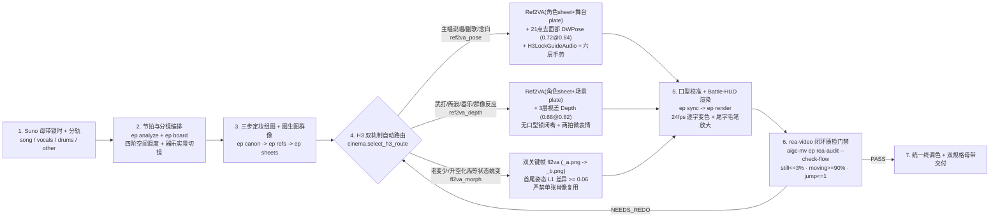

# 《火影有嘻哈 EP03》`rea-video` 深度拉片与《异人开麦 ep03》`v3 → v6` 编排演进总结

本文档将 [JuneYaooo/rea-video](https://github.com/JuneYaooo/rea-video) 对参考片《火影有嘻哈 EP03：春野樱 VS 日向雏田》（`217.7s`）的确定性取证 + 多模态逐镜复核结论，与本仓《异人开麦 ep03：三重修在心里面》（`179.16s`）从 `v3 → v4 → v5 → v6` 四轮迭代的实测数据合并，沉淀为后续所有剧集（`ep04+`、《一人之下》、《世界名人大乱斗 / 异人开麦》）的标准编排与生成规范。

---

## 一、`rea-video` 深度拆解《火影有嘻哈 EP03》：真正拉开差距的 6 个优点

通过 `rea-video decompose` + 67 镜联系表逐镜复核（`rea-video apply-review`），参考片的核心指标与设计长板如下：

### 1.1 定量基线（已固化为 `aigc_mv.rea_audit.HUOYING_BENCHMARK`）

| 维度 | 《火影有嘻哈 EP03》实测值 | 编排门禁（`ep rea-audit`） | 关键启示 |
| --- | --- | --- | --- |
| 总时长 / 镜头数 | `217.7s` / `67` 镜 | - | 约 `97.5 BPM` Boom-Bap，平均 `3.25s`（中位 `2.93s`，`18.2` 刀/分），绝不一字一碎切 |
| `still_motion`（静图推拉/定格） | **`0.8%`**（仅高潮灭灯远景 1 镜） | **`<= 3.0%`** | 连 `shot_009` 这种慢推过肩镜都有「严肃→挑眉坏笑」微表情，几乎零真静帧 |
| 动态机位占比（移动 + 手持） | **`100%`**（慢推/摇移/呼吸微晃） | **`>= 90.0%`** | 没有任何一镜是死板像素静止，哪怕固定构图也带真实摄影师呼吸漂移 |
| 同机位硬跳切（`jump`） | **`1` 处** | **`<= 1` 处** | 连续两镜同唱者必换景别（相差两档）或插入过肩/听者/观众反应 |
| 景别分布 | `MS 49% · MCU 27% · CU 16% · WS 8%` | `>= 3` 类主力景别 | 中景看肢体手势、近景/特写看眼神嘴型、远景立空间轴线 |
| 成片胶片质感 | 原生 30fps 导出 + 细颗粒 `σ≈0.4–0.9` | 统一终调色 + 颗粒 | 写实度高到 `rea-video` 像素噪声取证将 12% 镜头判为接近真实相机实拍 |

### 1.2 六条必须吸收进工作流的导演技法

1. **冷开场「实景角色器乐 + 前景遮挡横移揭幕」（`shot_001`，`0.0–5.1s`）**
   - 开场不是空洞大远景，而是**本片角色亲自在擂台中央演奏乐器**（紫发小南弹白色大竖琴、白纸蝶飞舞），立体主标题砸入后收至右下角常驻角标，摄影机**越过竖琴前景向右推摇**自然揭出沙发评委席与二层 DJ 台。
   - **落地规则**：前奏/间奏器乐切镜必须用 `instrument_stage`（本片角色如陆玲珑击红木战鼓、李慕玄抚古琴半身/中景实拍感入画），**严禁出现无身体的悬空双手敲鼓/拨弦**。

2. **单镜内「两到三拍空闲手进出画切换」（`shot_012`，`37.8–41.6s`）**
   - 为什么参考片的主唱特写不尴尬？在 `3.8s` 单镜内，春野樱右手握麦锁死嘴斜下方，**左手完成「掌心向上勾指挑衅 → 随俯身下摆甩出画外 → 重音处重新从画外抬起直指镜头」三段式动作**。
   - **落地规则**：AI 视频最怕空闲手一直悬停在胸前做机械微抖。必须在提示词与姿态控制里让空闲手**有出画泄力、有再入画定拍**（已内置入 `cinema.GESTURE_PHASES` 与 `show.py` 自动轮换）。

3. **四阶空间调度递进（打破全程站桩对喷）**
   - **第一阶（分立建轴，`shot_006`）**：双人过肩正反打（`ots_hair`），前景保留对手虚化发丝与肩线，锁死「左阵营朝右、右阵营朝左」180° 轴线。
   - **第二阶（侵入私人空间，`shot_034`，`111.2s`）**：副歌火药味顶点切**正侧面鼻尖相距 5cm 贴脸硬顶**（`faceoff_profile`），唱者咬重字，听者双唇紧闭冷眼盯视。
   - **第三阶（下台破壁互动，`shot_041`，`138.7s`）**：雏田走下主擂台贴近前排护栏，对着台下被点名的鸣人面对面唱（已新增 `cinema.SHOW_STAGINGS["barrier_interact"]`）。
   - **第四阶（全场瞬灭 + 单束冷白顶光绝杀，`shot_056–058`，`190.6–197.3s`）**：绝杀句前全场红蓝氛围灯瞬间全灭，仅留一束高空冷白追光锥打亮背影剪影（`blackout_spot`），停顿蓄势后切正面急推大特写（低头扶立麦 → 缓抬眼露出白眼 → 冷笑吐出绝杀字）。

4. **反应镜头「两拍微表情转折」+ 听者铁律闭口（`shot_009 / 022 / 042`）**
   - 观众席鸣人（`shot_022`）不是一张静态笑脸，而是 `1.9s` 内完成**「愣住直视 → 挠头尴尬傻笑」**两拍转折；评委沙发（`shot_042`）同框三人一个憋笑一个冷峻；过肩镜里的非唱方**100% 全程闭口**，绝不跟唱串嘴。
   - 观众与客串反应**优先基于已有官方定妆/剧照做图生图（`img2img`）**保持画风与面孔锚定，严禁纯文生图随机捏路人导致审美断层。

5. **声腔与面部幅度强绑定（高音大开颌 vs 鼻音闭口）**
   - 高音副歌/爆发句必须写明「下颌自然大幅张开、苹果肌抬起、脖颈发力清楚」，同时**不能用带面部僵死关键点的骨骼图锁死下巴**；反之，像陆瑾结尾的鼻音「哼」或冷笑尾音，必须写明**全程双唇紧闭**，靠鼻翼、挑眉与下颌微昂演戏。

6. **综艺/战斗 HUD 视觉包装层（`packaging/timeline.json`）**
   - 常驻品牌角标 + 开场阵营印章名牌 + 底部高对比度歌词（重音尾字放大跳出 + 典故底注胶囊），跨切点保持视觉整体感（已升级固化为 `overlays.py` 的 `subtitle_style: battle_hud` 与 `lyric_karaoke`）。

---

## 二、《异人开麦 ep03》`v3 → v4 → v5 → v6` 实测消融：为什么旧版「全员 `fl2va`」会卡死？

在 `ep03` 实战前，旧版 Playbook 曾规定「人物主镜一律 `fl2va`、禁止 `ref2va`」。但在 H3 + 音频锁口型（`H3LockGuideAudio`）管线中，经过 `rea-video` 与 160×90 光流逐镜检测，我们定位了「画面像静帧、手势全程不变」的真正根因：

| 版本 | 核心生成策略 | `rea-video` `still_motion` | 移动+手持机位 | 同机位跳切 `jump` | 15 个问题镜中位光流均值 | `ep rea-audit` 结论 |
| --- | --- | --- | --- | --- | --- | --- |
| `v3` | 早期混剪（单景别堆叠、无严格轴线与声部核对） | `3.0%` | `100%`（纯拉镜） | `7` 处 | - | **FAIL**（7 跳切、92% 单一近景、男女声串唱） |
| `v4` | 单张静态立绘喂 `fl2va` + 音频锁口型 | `13.8%`（`24.75s`） | `73.6%`（固定占 `26%`） | `3` 处 | `0.28 px` | **FAIL**（锁首帧导致大量站桩静帧、悬空手击鼓） |
| `v5` | 补齐老变少双关键帧、陆玲珑实景击鼓、图生图观众 | `10.0%`（`17.92s`） | `82.6%`（固定占 `17%`） | `2` 处 | `0.306 px`（`1:03` 仅 `0.008 px`） | **FAIL**（说唱主镜仍受单图 `fl2va` 锁首帧影响，手势僵死） |
| **`v6`** | **H3 双轨制路由（`Ref2VA + ControlNet Union 2.0 Pose/Depth` + 六层生物力学 + 24fps Battle-HUD）** | **`2.2%`（`4.00s`）** | **`97.0%`（固定仅 `3%`）** | **`1` 处** | **`1.078 px`（提升 `3.52×`）** | **PASS（全面对齐《火影有嘻哈》基准）** |

### 根因复盘：单图 `fl2va` 的两大物理死结

1. **Frame-0 像素硬锁死（Repeated Frozen Hand Pose）**：
   - 当同一张角色半身定妆图（如陆瑾抬右手半身照）作为 `first_frame` 喂入多个说唱镜头时，H3 在第 0 帧被像素级锁死；一旦叠加 `H3LockGuideAudio`，模型算力集中于驱动嘴唇像素，躯干与手臂直接退化为「数字人口播态（Talking-Portrait Body Freeze）」，导致 `0:33 / 0:40 / 2:07` 手势一模一样、`1:03` 全画幅光流跌至 `0.008 px`！
2. **ControlNet 权重与 `end_percent` 渗色陷阱**：
   - 若直接把骨骼线或深度图开到 `strength=1.0, end_percent=1.0`，成片暗部会残留彩色火柴人线条或深度灰雾；若骨骼图保留 68 个面部关键点，高音唱段的嘴型又会被参考视频的小口型锁死。

---

## 三、全新标准工作流：H3 双轨制路由 + 六层动作解耦 + `rea-video` 闭环

已在代码层（[`cinema.py`](../src/aigc_mv/cinema.py)、[`packs.py`](../src/aigc_mv/packs.py)、[`rea_audit.py`](../src/aigc_mv/rea_audit.py)、[`overlays.py`](../src/aigc_mv/overlays.py)）全面实装：



### 黄金参数速查表（ComfyUI `MiniMax-H3-Fun-Controlnet-Union-2.0`）

| 轨道模式 | 适用镜头 | 参考图输入 | ControlNet 类型与预处理 | `strength` | `end_percent` | 口型与提示词要点 |
| --- | --- | --- | --- | --- | --- | --- |
| **`ref2va_pose`** | 主歌说唱、高音副歌、主持/老年对白 | `[角色_sheet.png, 舞台空镜.png]` | `DWPose` 仅保留 **21 个躯干+手臂+五指关键点**，**剔除全部面部点** | `0.68–0.75`（默认 `0.72`） | `0.80–0.86`（默认 `0.84`） | 开启 `H3LockGuideAudio`；提示词带 `BIOMECH_SUNG_CN` 六层发力与空闲手进出画切换；高音写明大开颌 |
| **`ref2va_depth`** | 武术招式、炁浪爆发、实景击鼓抚琴、图生图观众反应 | `[角色/群像基准图.png, 舞台空镜.png]` | `Depth Anything V2` 三层景深视频（前景遮挡+中景主体+背景散景） | `0.62–0.74`（默认 `0.68`） | `0.80–0.84`（默认 `0.82`） | 关闭口型驱动，写明全员闭口与两拍情绪转折；`end_percent <= 0.84` 彻底杜绝深度灰雾残留 |
| **`fl2va_morph`** | 老年→少年跨龄变身、全场灭灯追光揭晓、宗师升空化白炁 | `first_frame=_a.png`, `last_frame=_b.png` | 双关键帧首尾锚定（无需额外线框） | `1.0` | `1.0` | `_a` 与 `_b` 必须通过五项硬检且**肢体姿态显著不同**；严禁把同一张静态肖像同时当首帧重复喂给多个说唱镜头 |

---

## 四、一键执行闭环命令

```bash
# 1. 生成分镜与带 H3 双轨路由元数据的提示词包（units/<id>/request.json 含 h3_routing）
aigc-mv ep board projects/<ep>
aigc-mv ep prompts projects/<ep>

# 2. 渲染带 Battle-HUD 印章与毛笔尾字重音的成片（episode.yaml 设 subtitle_style: battle_hud）
aigc-mv ep render projects/<ep> --res 1080p

# 3. 使用 rea-video + 光流检测对照《火影有嘻哈》基准做闭环审计，自动生成靶向返修处方
aigc-mv ep rea-audit projects/<ep> --check-flow --strict
# 或直接审计任意已渲染成片并与参考片 breakdown 对照：
aigc-mv ep rea-audit path/to/cut.mp4 --ref-rea path/to/rea_huoying --check-flow
```
